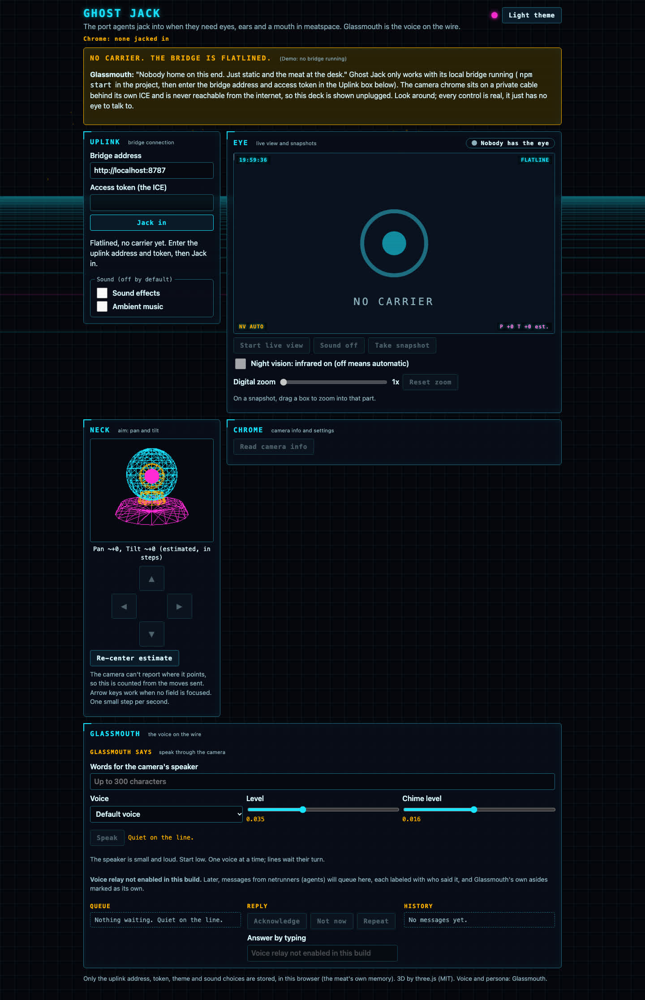

# Ghost Jack

**Ghost Jack: the port agents jack into when they need eyes, ears and a mouth in meatspace. Glassmouth is the voice on the wire.**



Ghost Jack gives AI agents (netrunners) a body in the meat world: a cheap network camera for an eye and ear, a neck that pans and tilts, and a speaker for a mouth, all run locally, with no cloud app. **Glassmouth** is the night-shift voice on the wire: one glass eye, a dozen voices ([the guide](docs/glassmouth.md)). The first supported chrome (hardware) is the Tethys 825-C (SKU TT000074), a $2 thrift-store camera.

**For strangers, in plain words:** this is a local program (the bridge) plus a web page (the deck) that controls a compatible network camera: see, listen, aim, turn on night vision and speak through its speaker. You need a compatible camera (so far only that model) on a private cable or network, a Mac (the bridge reads the camera's password from the macOS Keychain and uses macOS speech), Node and ffmpeg (the regular build is enough: tested with Homebrew `ffmpeg` 9.0.1; `ffmpeg-full` isn't needed). The bridge runs on your machine behind its own ICE (an access token); the hosted page is only its remote control and shows a demo when no bridge answers. The deck has a neon cyberpunk look: a live Eye panel with an on-screen display, a wireframe 3D camera model that turns to the estimated aim, a pan/tilt pad, night vision, zoom, camera settings, a "Glassmouth says" box, optional generated sound and a light theme. Every cryptic label has a plain-language sublabel.

## Quick start

```sh
PLAYWRIGHT_SKIP_BROWSER_DOWNLOAD=1 npm install   # uses an installed Chromium
security add-generic-password -s tethys-camera -a <device id> -w   # once: stores the camera's password
npm start                                          # http://127.0.0.1:8787; prints an access token once
```

Open `http://localhost:8787/`, paste the token and Jack in (Connect). Flatline means the bridge isn't running or the camera isn't answering. Details, the API and Tailscale: [docs/bridge.md](docs/bridge.md). Changes: [CHANGELOG](CHANGELOG.md). Licensed MIT ([LICENSE](LICENSE), [NOTICE](NOTICE.md)).

## Docs

- [The bridge and control page](docs/bridge.md): endpoints, say, the stream, Tailscale, GitHub Pages.
- [Finding the camera](docs/discovery.md): the dated log from "is the USB cable data?" to signing in, moving, streaming, listening and talking.
- [Glassmouth](docs/glassmouth.md), [voice relay plan](docs/voice-relay-plan.md), [room map plan](docs/room-map-plan.md).
- `tools/`: the original probes (`snapshot.mjs` saves one snapshot; `web-login-probe.mjs` records the web app's requests after sign-in). They read the same Keychain item `tethys-camera` (the name stays: it is this camera's credential) and need Playwright (`PLAYWRIGHT=<path>/playwright-core/index.mjs`).

## Privacy

The camera stays on a private cable with no cloud account, and no pictures, video, audio or camera credentials from it are ever committed here. Rules for anyone (or any agent) working on the code are in [AGENTS.md](AGENTS.md).

## Supported cameras

| Camera | Status | Notes |
| --- | --- | --- |
| [Tethys 825-C](docs/cameras/tethys-825-c.md) (MIPC family) | Working: see, listen, aim, night vision, speak | The first and only camera so far. |

Each camera gets its own page in `docs/cameras/` with what's known about it, how Ghost Jack talks to it, and its quirks.

## Roadmap

1. Voice relay: agents ask, the camera speaks, the answer is heard and transcribed ([plan](docs/voice-relay-plan.md)).
2. Room map with re-sweep ([plan](docs/room-map-plan.md)).
3. MCP tools so agents can "jack in" (look, listen, aim, say).
4. Local TTS voices per agent (the `synthesize()` boundary in `src/say.mjs`).
5. Pan/tilt calibration on a tripod.
6. Check live-stream playback in Safari.
7. Set the clock automatically on connect after a power loss.

## Credits

The control page's 3D uses [three.js](https://threejs.org) (MIT), loaded from a CDN at run time and not bundled. See [NOTICE](NOTICE.md).
